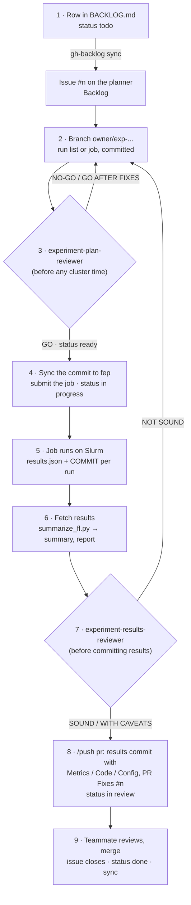

# Tutorial: one experiment from backlog row to merged PR (E0)

A demo of how we run an experiment, on the real WISDM data, that takes a few minutes on the cluster. It trains a
centralised FCN and FedAvg / FedBN on S2 (user-level Dirichlet, K = 5) for **fold 0 and seed 1 only**, with a short
budget (5 epochs, 10 rounds). The numbers show where everything comes from; they are **not a result** (a real
experiment is 5 folds × 3 seeds, compared paired with Holm, see [`.claude/experiment-review.md`](../.claude/experiment-review.md)).

The experiment is row **E0** of [`BACKLOG.md`](../BACKLOG.md). Moving it through the steps below also moves its
issue across the [planner](https://github.com/users/ad-diaconu/projects/2).

## The flow



| Step | Who / what | When | Produces |
|---|---|---|---|
| 1 | A row in `BACKLOG.md`, then `python .claude/skills/gh-backlog/sync_backlog.py --apply` | Someone has an idea for an experiment | The issue `E<n>: ...` in Backlog |
| 2 | You: a branch (CONTRIBUTING.md §3), the run list in `experiments/runs/` or a job in `Fep/jobs/` | Before anything runs | Committed code and config |
| 3 | `experiment-plan-reviewer` (Claude Code agent, read-only) | **Before** submitting: a wrong job costs one of our 2 cluster slots | `GO` / `GO AFTER FIXES` / `NO-GO`, with the hypothesis, what would refute it, the expected result and the cost |
| 4 | Sync the commit to fep, `bash Fep/submit.sh ...` | After `GO` | A Slurm job ID and its log in `~/AITDM_Project/slurm/` |
| 5 | Slurm | Minutes to hours | `results.json` (+ `COMMIT`) per (fold, seed) |
| 6 | Fetch the run folders (without `*.pt`), `experiments/summarize_fl.py` | When the job has finished | `summary_fl.json`, `report.html` |
| 7 | `experiment-results-reviewer` (Claude Code agent, read-only) | **After** the run, before committing results or putting them in the report | `SOUND` / `SOUND WITH CAVEATS` / `NOT SOUND`, the claims we may make and the commit trailers |
| 8 | `/push pr`, or by hand per CONTRIBUTING.md and the PR template | After `SOUND` | `results(...)` commit, PR with `Fixes #n` |
| 9 | A teammate | After the PR is open | Merge closes the issue; set the row to `done` and sync |

Both reviewers read [`.claude/experiment-review.md`](../.claude/experiment-review.md) first: the rules (test users
decide nothing, 15 paired runs, one change at a time, committed code only) and the Stage 1 numbers to compare with.
The plan reviewer writes down the hypothesis and the expected result; the results reviewer checks the outcome against
exactly that, so the two reviews bracket the run. Neither edits files.

## Running E0 on the cluster

Once per person: [Fep/01_environment_setup.md](../Fep/01_environment_setup.md) (clone, `bash Fep/setup_fep.sh`,
the WISDM windows). Then on the login node:

```bash
cd ~/AITDM_Project/AITDM && git pull          # or the aitdm-sync skill from your laptop
bash Fep/submit.sh tutorial                   # dgxa100; if it is busy: bash Fep/submit.sh -p ucsx tutorial
squeue --me                                   # PD = waiting, R = running
tail -f ~/AITDM_Project/slurm/aitdm-tutorial-<id>.out
```

The job ([`Fep/jobs/tutorial.sbatch`](../Fep/jobs/tutorial.sbatch)) takes a few minutes of GPU time once it starts.
It empties `outputs/tutorial/` (git-ignored), builds the S2 K = 5 partitions if they are missing, then runs:

1. `experiments/centralised.py --model fcn --fold 0 --seeds 1 --epochs 5`: the pooled-data reference.
2. `experiments/run_seeds.py --split s2 --clients 5 --strategy fedavg|fedbn --folds 0 --seeds 1 --rounds 10`: one
   Flower simulation each, 5 clients as Ray actors on the same GPU.
3. [`experiments/tutorial.py`](../experiments/tutorial.py): one table at the end of the log.

What to point at in the table:

- **best ep/rnd** was chosen on the validation users; test is only reported (rule 1).
- **worst client** next to the pooled test F1: on S2 the pooled number hides the small skewed clients, and FedBN's
  personalised BatchNorm is what lifts them (Stage 1: worst client 0.135 → 0.280).
- **FedBN (global BN)** ≈ FedAvg: the gain is the local BN layers, not the training.
- **LyingDown** stays near zero everywhere: the open question RQ8 (E15–E18).
- The **Stage 1** column is 15 runs with the full budget; one short run can land anywhere around it.

To look at it locally, copy `outputs/tutorial/` back (`scp -r`, or the aitdm-fetch skill) and run
`python experiments/tutorial.py`. Without the cluster the same three steps run on a laptop CPU (add
`--gpus 0 --cpus 4` to `run_seeds.py`), but take much longer.

## The demo, step by step

1. Show row E0 in `BACKLOG.md` and its issue on the planner (Backlog).
2. `git switch -c <owner>/exp-tutorial-demo`. Nothing to write: the job already exists.
3. In Claude Code: *"run experiment-plan-reviewer on E0 (docs/tutorial.md, Fep/jobs/tutorial.sbatch); it is a
   pipeline demo, one fold and one seed by design"*. Read the verdict. Set E0 to `ready`, sync.
4. Submit as above, set E0 to `in progress`, sync. Follow the log.
5. Fetch `outputs/tutorial/`, run `python experiments/tutorial.py`.
6. *"run experiment-results-reviewer on E0, outputs in outputs/tutorial"*. Expect `SOUND WITH CAVEATS`: one fold, one
   seed, short budget, nothing can be claimed. That is the point: the reviewer says what a real run would need.
7. Results stay out of git (`outputs/tutorial/` is ignored), so there is no `results(...)` commit. Set E0 to `done`
   (or reset it to `todo` for the next demo) and sync.
